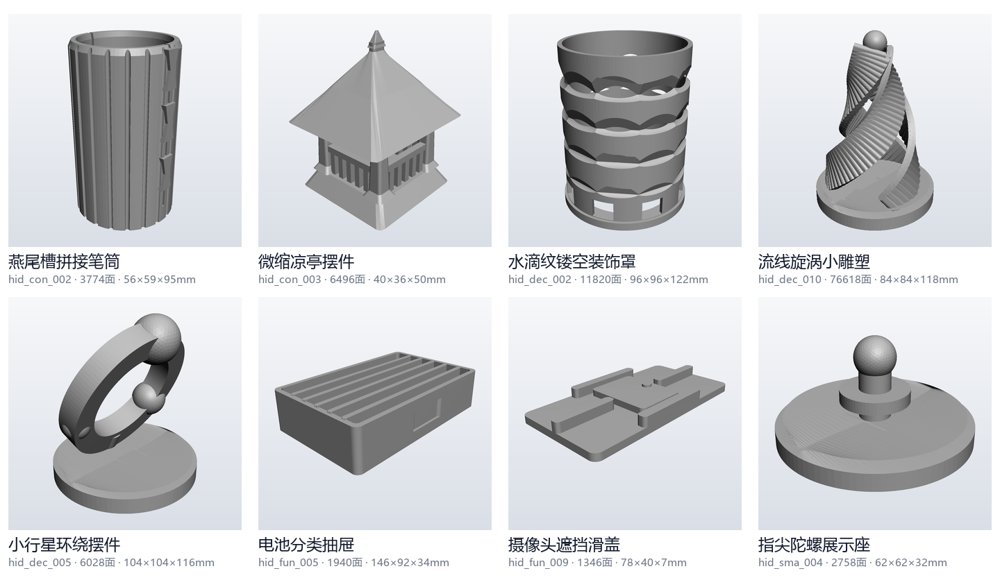

# Text2CAD-Parametric

中文工程描述 → 参数化 CAD → 严格水密可打印实体。



> 上图为 40 个专用建模器在**官方题目集**上的真实输出，由本仓库的 `src/render_offline.py` 渲染。
> 官方题库文件未包含在本仓库中（原因见「两级建模」一节）。

本仓库是一套「文本生成 3D」的**参数化实现**：不做文生 3D 扩散模型，而是把中文工程题干
解析成结构化硬指标，再交给参数化建模器直接构造实体，用严格布尔运算保证水密，
并在**建模阶段**就把 FDM 可制造性（免支撑、底面稳定）设计进去。

## 总体思路

```
中文题干 ──► ① 任务结构化 ──► ② 参数化建模 ──► ③ 严格布尔 ──► ④ 可制造性体检 ──► 水密实体 + 四视图
              taskspec        builders_*         cadlib          printability
              generic_builder                  (manifold3d)     validate
```

1. **任务结构化**（`taskspec.py`）：把题干的布尔标签与中文里的数值约束（如
   「整体高度不超过 90 毫米」）合并成结构化硬指标。
2. **参数化建模**（`builders_*.py` / `generic_builder.py`）：每道题对应一个专用建模器；
   遇到没见过的题干则走 `generic_builder` 泛化兜底。
3. **几何内核**（`cadlib.py`）：Shapely 负责二维轮廓与镂空阵列，manifold3d 负责严格
   布尔以保证水密与单连通，`loft_solid` 变截面放样用于免支撑设计。
4. **可制造性体检**（`printability.py` / `validate.py`）：逐题量化悬垂面积占比、壁厚、
   底面接触面积、质心稳定性，并按约束项判定通过与否，形成「生成—自检—修正」闭环。
5. **输出**（`render_offline.py` / `render_views.py` / `infer.py` / `pipeline.py`）：
   导出 GLB，渲染 front / side / top / perspective 四视图。

## 目录

```
src/
  taskspec.py             题干 → 结构化任务（含尺寸数值解析）
  cadlib.py               几何内核：二维轮廓 / 严格布尔 / 变截面放样
  builder_api.py          建模器公共契约（毫米、Z 向上、底面 Z=0、水密单连通）
  builders.py             建模器注册表
  builders_constrained.py 受尺寸/结构约束的工程件
  builders_decorative.py  装饰件
  builders_functional.py  功能件
  builders_small.py       小型件
  generic_builder.py      泛化兜底：任意题干 → 参数化实体
  printability.py         FDM 可制造性度量与综合评分
  validate.py             按约束逐项校验并给出整改建议
  infer.py                统一推理入口
  render_offline.py       纯 numpy + Pillow 的离线四视图渲染
  render_views.py         Blender Cycles 四视图渲染（可选）
  pipeline.py             批量生成与打包
samples/
  prompts_sample.jsonl    5 道自带演示题（无需额外数据即可跑）
examples/
  sample_sma_001/         演示题的完整产出（GLB + 四视图 + metadata + process）
```

## 安装

```bash
pip install -r requirements.txt
```

> 注意：`manifold3d` 不能省，它是 `engine="manifold"` 的后端。
> 另有一个坑：**清华 PyPI 源最高只有 `manifold3d 2.5.1`，没有 3.x**，
> 用它安装会失败，请改用阿里云源或 pypi.org。

## 快速开始（可直接复现）

仓库自带 5 道演示题，**不需要官方题库**：

```bash
python src/infer.py samples/prompts_sample.jsonl out
```

实测 5 题共 **10.8 秒**（平均 2.2 秒 / 题，最长 3.2 秒），产出：

```
out/
  manifest.json                 全量清单（含耗时、面数、包围盒、水密性）
  _logs/{env.log,run.log,errors.log}
  sample_sma_001/
    model.glb                   主模型（毫米，Z 向上，底面 Z=0）
    metadata.json               单题元信息
    process.md                  自然语言说明（改进点 / 后处理流程 / 失败样例与修正）
    renders/{front,side,top,perspective}.png
```

`examples/sample_sma_001/` 是同一批演示题的产出之一。已实测核对：它的
`model.glb` 与四张渲染图**与你跑出来的结果逐字节一致**，只有 `metadata.json` /
`process.md` 里的耗时字段会随机器不同而变。

### 输入 JSONL 格式

每行一个 JSON 对象：

| 字段 | 必填 | 说明 |
|---|---|---|
| `prompt_id` | 是 | 题目编号。**命中专用建模器表就用专用建模器，否则走泛化兜底** |
| `prompt` | 是 | 中文题干原文（尺寸数值就写在这里，会被解析成硬约束） |
| `category` | 否 | `constrained` / `decorative_object` / `functional_object` / `small_object` |
| `prompt_intent` | 否 | 题干意图简述，会一并参与关键词解析 |
| `constraints` | 否 | 5 项布尔标签：`single_component`、`no_floating_parts`、`stable_base`、`watertight_required`、`size_constrained` |

也可以用 Python 直接调：

```python
import sys; sys.path.insert(0, "src")
import builders                                  # 导入即注册全部建模器
from builder_api import BUILDERS, finalize
from generic_builder import build_generic
from taskspec import Task

task = Task(prompt_id="demo", category="functional_object",
            prompt="生成一个桌面手机支架，整体宽度约 90 毫米，背面平整，不得使用支撑。",
            prompt_en="", prompt_intent="",
            constraints={"single_component": True, "no_floating_parts": True,
                         "stable_base": True, "watertight_required": True,
                         "size_constrained": True}, size={})

# 命中专用建模器就用专用建模器，否则走泛化兜底
mesh = finalize(BUILDERS.get(task.prompt_id, build_generic)(task))
print(mesh.extents, mesh.is_watertight)
# -> [90.0, 63.0, 60.0] True
```

## 两级建模

这是本方案的核心结构，**也是理解 `preview.png` 为什么好看而演示题输出比较朴素的关键**：

| | 专用建模器 | 泛化兜底层 |
|---|---|---|
| 位置 | `builders_{constrained,decorative,functional,small}.py` | `generic_builder.py` |
| 数量 | 40 个，按 `prompt_id` 绑定 | 1 个，任何题干都接 |
| 触发 | `prompt_id` 命中注册表 | 未命中时自动兜底 |
| 做法 | 针对该题的尺寸与结构逐一手写参数化程序 | 正则抽尺寸 + 关键词选 8 种原型（box/plate/bracket/hook/tube/wedge/ring/arch） |
| 效果 | 造型贴合题干，含燕尾槽、滑轨、钥匙孔等配合特征 | 只保证**合法**（水密/单体/无悬浮/稳定底/尺寸合规），不保证**形似** |

因为专用建模器是按官方题目编号绑定的，而本仓库不包含官方题库，所以
`samples/prompts_sample.jsonl` 里的 5 道自拟题**全部会走泛化兜底**（产出里
`builder` 字段会显示 `generic`）。要看专用建模器的效果，就是开头那张 `preview.png`。

### 用官方题库跑专用建模器

把官方题库放到 `data/prompts_test.json`（字段结构同上面的 JSONL），然后：

```bash
python src/pipeline.py
```

## 关键设计要点

- **尺寸可控**：题干的毫米级数值直接写进参数化程序，不依赖模型猜测。
  实测：题干写「不超过 90 毫米」→ 输出 89.82mm；「不超过 120 毫米」→ 119.76mm。
- **免支撑是设计出来的**：朝下的面一律设计为 ≤45° 自支撑斜面（变截面放样、把半圆拱
  改成尖拱等），而不是靠切片器加支撑。
- **打印就位机构**：活动件靠 **0.4mm 分层平行间隙**实现，打印完即可动作，无需装配。
- **水密性**：全部布尔运算走 manifold3d 严格模式，输出为水密单连通实体。

## 已知局限

如实记录两处已定位但**未在本版本修复**的问题（保持公开代码与参赛提交版本一致）：

1. **泛化层只保证合法、不保证形似。**
   实测：题干「中央立起一条螺旋扭转的带状造型」→ 泛化层输出一根光杆圆柱（专用建模器
   同类题 `hid_dec_010` 能正确做出三条盘旋曲带）。尺寸约束是听话的，造型还原度低。

2. **泛化层的原型路由存在关键词撞车。**
   `_ARCH_KEYWORDS["bracket"]` 收了「支撑」，而题干里的「免支撑 / 不得使用支撑」指的是
   **3D 打印支撑**，不是承重支架。语义撞车后分数盖过了真正的关键词，导致
   「壁挂小托盘」「路由器壁挂支架」「齿轮形靠墙支架」三道不同的题**输出同一个
   1018 面的 L 型件**。修法是把「支撑」从 `bracket` 词表里去掉并改用「支架 / 托架」等
   更具体的词——本版本未改，以保持与提交版本一致。

## 备注

`render_views.py` 依赖 Blender 的 `bpy`，需在 Blender 环境内运行；推理链路
（`infer.py`）使用的是不依赖 Blender / OpenGL / GPU 的 `render_offline.py`。
